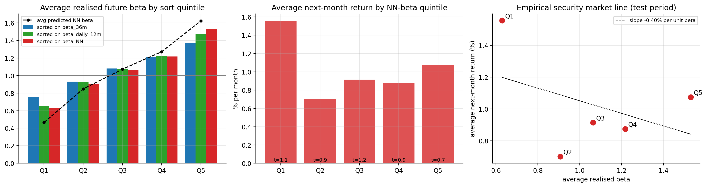
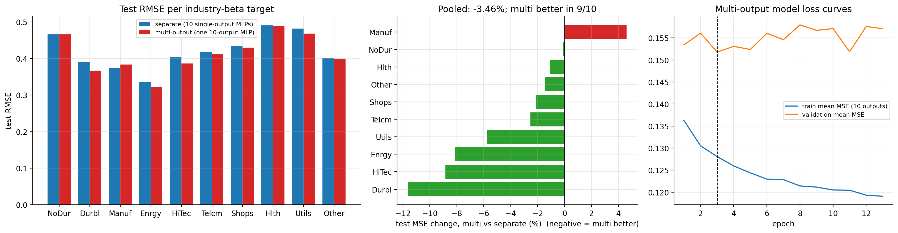

# Forecasting Market and Industry Betas with Neural Networks

Can a stock's future market beta be forecast better than by the usual rolling-window estimates? At the end of each month, a small feed-forward network uses twelve historical risk, return and size variables plus the firm's industry to predict the daily-return beta the stock will have over the next 12 months. It is judged on 2018–2022 data it never saw during training or model selection.

## Key results

| | |
|---|---|
| vs. trailing daily beta | **−30% MSE** (RMSE 0.443 vs 0.530, Newey–West t = 9.4); lower error in all 60 test months |
| vs. 36-month rolling beta | out-of-sample R² = **0.76** |
| Risk sorting | realized beta rises from **0.63 to 1.53** across forecast quintiles, monotone in all 60 test months |
| Multi-output network | one 10-output net beats ten separate nets for **9 of 10** industry betas (pooled MSE −3.5%, NW t = 3.8) |

## Data

The data are **not included**: CRSP is licensed through [WRDS](https://wrds-www.wharton.upenn.edu/).

- **CRSP** monthly and daily stock files, 1996–2023, used to build monthly rolling betas (12/24/36 months), the trailing 12-month daily beta, volatility, idiosyncratic volatility, momentum, size and the target: the realized daily-return beta over months *t+1* to *t+12*.
- **[Kenneth French Data Library](https://mba.tuck.dartmouth.edu/pages/faculty/ken.french/data_library.html)**: 10 industry portfolios (daily, value-weighted) and the risk-free rate, used for the industry betas.

The notebook expects `data/neural_beta_panel_1996_2023.csv.gz` (1,636,563 firm-months, 42 columns: identifiers, dates, predictors, targets and sample flags) and `data/variable_definitions.csv` (each column's role and predictor group).

| Split | Forecast months | Firm-months | Firms |
|---|---|---|---|
| Train | 1998-12 to 2011-12 | 589,239 | 7,727 |
| Validation | 2013-01 to 2016-12 | 138,516 | 3,547 |
| Test | 2018-01 to 2022-12 | 170,650 | 3,678 |

One-year gaps between splits keep the 12-month targets from overlapping. Preprocessing is fit on training data only.

## Method

- **Benchmarks:** rolling 12-, 24- and 36-month monthly betas, the trailing 12-month daily beta, and a constant beta of 1.
- **Model:** MLP (22 inputs → 32 → 16 → 1) with early stopping, selected on validation from four configurations, plus OLS on the same inputs as a linear reference.
- **Evaluation:** test RMSE/MAE, out-of-sample R², Newey–West t-statistics on monthly loss differences (Diebold–Mariano style), and errors by firm size and industry.
- **Economics:** quintile sorts on the forecast, comparing realized beta and next-month returns (the security market line).
- **Interpretation:** permutation importance by predictor group and by variable.
- **Extension:** one network with ten outputs (FF10 industry betas) vs. ten single-output networks, across three random seeds.

## Findings

**The network beats every benchmark, mostly by shrinking.** One unit of historical daily beta is followed by only 0.51 units of realized beta, so historical estimates are too extreme. The network's forecasts are much better scaled. A linear model on the same inputs recovers most of the gain (RMSE 0.455); the non-linear part adds a smaller but reliable improvement (t = 3.9), mainly among the largest firms.

| Forecast | Test RMSE | R² OOS vs 36m beta |
|---|---|---|
| MLP | 0.443 | 0.760 |
| OLS, same inputs | 0.455 | 0.747 |
| Trailing daily beta | 0.530 | 0.657 |
| Constant 1.0 | 0.541 | 0.643 |
| 36-month rolling beta | 0.905 | 0 |

**Sorting on the forecast separates risk, not returns.** Realized beta rises from 0.63 to 1.53 across quintiles, a wider and more reliable spread than sorting on the daily beta or the 36-month beta. The high-minus-low return is −0.48% per month (t = −1.1): a flat security market line.



**What drives the forecast.** Shuffling historical risk raises test RMSE by 35%, returns and size by 17%, and industry by 1%. Nearly all of it comes from the trailing daily beta and log market cap.

**Limits.** The network ranks firms well within a month but misses market-wide swings in beta around COVID, and it under-predicts the smallest firms in the test period. Its edge over the daily beta shrinks from training to validation as a thin-trading pattern among small firms in 1998–2002 holds less well later.



## How to run

```bash
python -m venv .venv && source .venv/bin/activate
pip install -r requirements.txt
# place the panel and variable definitions in data/
python build_notebook.py          # assembles cells/step*.py into neural_beta.ipynb, executes it, exports HTML
# or open neural_beta.ipynb directly in Jupyter
```

## Repo layout

```
neural_beta.ipynb      full analysis with outputs
cells/step00–10_*.py   notebook source, one file per step (# %% cell markers)
build_notebook.py      builds and executes the notebook from cells/
results/               aggregate result tables (CSV)
figures/               all figures produced by the notebook
```

## License

MIT. See [LICENSE](LICENSE).
